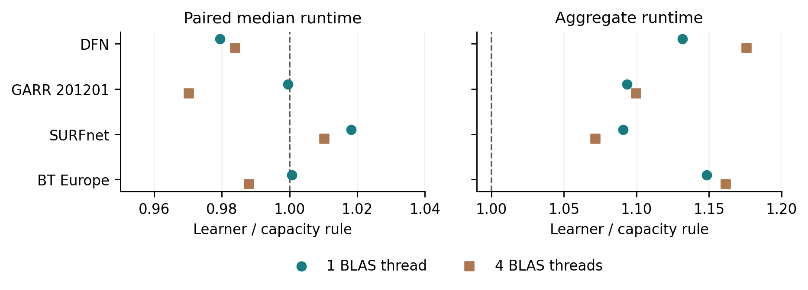

# Certified Network Optimisation

**Utility certificates and the computational value of algorithm selection.**

This personal research project studies repeated network utility maximisation
after link capacities change. It combines a computable primal–dual utility-loss
bound, inexpensive numerical updates, and a learned choice of update action.
The numerical certificate determines acceptance; the policy only chooses how
much computation to perform.

**[Read the ten-page paper](paper/Certified_Network_Optimisation.pdf)** ·
[Editable manuscript](paper/Certified_Network_Optimisation.docx) ·
[Reproduction instructions](REPRODUCING.md)

## Main findings

| Experiment | Saved observations | Main result |
|---|---:|---|
| Original NUM benchmark | 600 capacity cases; 7,200 timings | The precheck certifies 216/576 core updates. Median paired reuse/ray-warm time is 0.95 overall and 1.03 for nonuniform changes. |
| Topology-held-out learning evaluation | 768 updates; 13,824 fresh timings | A learned selector does not consistently improve on an inexpensive capacity rule. |
| Frozen policy on four unused graphs | 256 fresh updates; 9,216 timings | Learner/rule aggregate cost ratios are 1.108 and 1.115 under one and four configured BLAS threads on the same CPU. |

All reported failures remain in the raw observations. The original scaling
extension has 12 failed timing runs; the shifted learning replay has 18; the
fresh-graph follow-up has none. The primary utility gap per total weight is
0.001. Timing repetitions are execution observations, not independent networks.



## Reproduce the saved results

Use Python 3.12. Install the recorded numerical and learning dependencies:

```bash
python -m venv .venv
# Activate the environment for your operating system.
python -m pip install -r requirements-learning.txt
python download_data.py
python audit_saved_results.py
cd dis_extension
python audit_extension.py
python transfer_study.py audit
```

The data command downloads the complete source-and-data release asset, checks
its SHA256 digest and its 1,243-entry file manifest, and installs the saved
result arrays and observations. It leaves source files and the paper intact.
An existing different result file causes it to stop instead of overwriting it.
For offline use, download the release ZIP and pass its path with `--archive`.

The Git repository holds the code, protocols, fitted policies, summary results,
topology sources and current paper. Larger arrays and raw timing records are
in the release asset
[`Certified_Network_Optimisation_Source_and_Data.zip`](https://github.com/galahad3723-blip/certified-network-optimisation/releases/download/v0.1.0/Certified_Network_Optimisation_Source_and_Data.zip).
The archive digest is
`d9bb706e47f1c8ee990c937d78660e7ec09a428fa37cdcf8cab80dfd1a1543cc`.

## Code map

- `certified_num.py`: utility model, dual bounds, feasibility repair and shared solver.
- `THEORY.md` and `FINITE_ANCHOR_EXTENSION.md`: analytical statements and proofs.
- `run_benchmark.py`, `analyse_benchmark.py`: original benchmark and analysis.
- `dis_extension/certified_updates.py`: bounded correction and portable policy inference.
- `dis_extension/train_policy.py`: nested validation with complete topologies held out.
- `dis_extension/experiment.py`: action collection and paired evaluation.
- `dis_extension/transfer_study.py`: frozen-policy follow-up and stored-state audit.
- `results/summary.json`, `dis_extension/results/summary.json`, and
  `dis_extension/transfer_results/summary.json`: measured headline results.

## Scope and data attribution

Ten historical topology structures come from Internet Topology Zoo, pinned to
commit `51118849b99534f01010d885d66321433a7eef9e`. Routes, weights, capacities
and shocks are generated; they are not production traffic measurements.
The follow-up compares two BLAS limits on one CPU, not different machines.
The study does not establish state-of-the-art solver superiority or publication
priority. See the paper for conditions on the analytical bounds and empirical
interpretation.

Topology data retain their upstream CC BY 4.0 attribution and licence in
`data/InternetTopologyZoo/LICENSE`; the four additional source files and hashes
are under `dis_extension/data_external/`. Third-party data licences do not
automatically license the original project code.

Author: Kai Chi. The paper is dated 15 October 2026; repository release metadata
records the actual public release date. Numerical execution records retain
their original chronology and source hashes.
